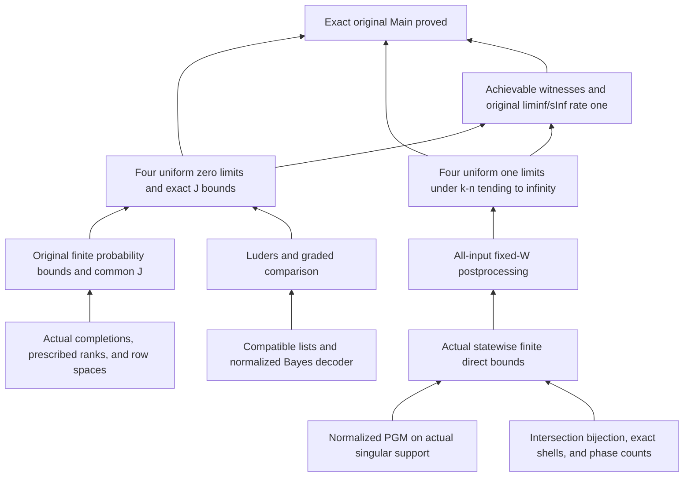

# One root project and its public interfaces

The current repository has one Lean/Lake configuration at the root: package `stabilizerLearning`, library `StabilizerLearning`. All mathematical source uses this namespace. The default entry point imports `StabilizerLearning.lean → Main.lean`.

The [paper index](../proofs/README.md) labels the existing proof as **lean proof of https://arxiv.org/abs/2609.13923** and links the separately buildable [arXiv:2610.00266 project](../proofs/arxiv-2610.00266/README.md). The architecture below describes the first-paper root project; the second has its own namespace, dependency locks and audits.

| Directory | Mathematical responsibility |
| --- | --- |
| Foundations | Finite fields, symmetric/rectangular rank counts, matrix completions, radicals, row spaces, and symplectic geometry |
| Quantum | Finite-dimensional density matrices and POVMs, concrete Pauli sections, compatible phases, and stabilizer inputs |
| FiniteCopy | Matrix optimization, normalized PGM on the actual singular support, Gram matrices, and finite-copy formulae |
| OddPrime | The paper's ordinary moment branch; generic algebraic lemmas introduce no unnecessary odd-prime assumption |
| Binary | Enhanced binary moments, Z₄ diagonals, and their counts |
| Bounds | Complete finite probability bounds, common-J converse, actual direct bounds, and rates |
| FixedConstraints | Original basis-free reports and Lüders verification, all-input postprocessing, the four optima, and covariance |
| Main | The exact original target and its complete proof |
| docs | Paper correspondence, design decisions, actual dependencies, and milestone acceptance |
| scripts | Builds, whole-project audits, release gates, integration, and static snapshots |
| Scratch | Experiments outside the formal root import chain |

The mathematical obligation graph and Lean proof-term dependencies serve different purposes. Importing `Verified.lean` puts auxiliary modules in the root build; it does not by itself show that Main uses them. [lean-dependencies.json](lean-dependencies.json) is extracted from kernel-checked declarations. [main-closure.json](validation/2026-10-11-direct-integration/main-closure.json) records the actual Main proof paths, including the specifically required dependencies.

Commit `d8d2b7f` preserves the former `pilot/` layout. [module-migration.json](module-migration.json) records the move file by file. Scripts under `scripts/history/` are historical report tools, not current verification commands. Historical evidence hashes bind the original versions; English translations are identified by the edition provenance.

## Ownership and parallel work

The coordinating task is the sole writer of the owner's Mac research checkout. Parallel writers use independent server directories and independent `codex/<task>` branches after a capacity check. Read-only semantic review can run concurrently. Shared Quantum/FixedConstraints definitions and the theorem map have one integration owner.

Agree on interfaces before assigning lemmas. After review, `scripts/merge_checked.py` can check a target commit with a build and recursive audit and permit only a fast-forward integration. Conflicts or divergence require deliberate resolution and new checks. Do not invoke this helper or merge main automatically.
