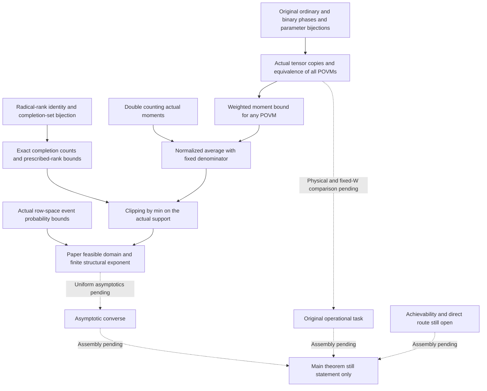

# Finite probability–completion reduction

This stage preserves the quantum states, all POVMs, and uniform priors of the original finite coordinate experiments. Key bijections, inclusions, probability bounds, and counting formulas are not premises of the final theorems. The main theorem `FixedWNoCopyRateDiscount` is still statement only at this stage. Full equivalence between the coordinate experiments and the uniform Pauli / fixed-W operational task is not assumed.

For the Lean parameters `m,n` used here, `n` is the lower-row count; the paper's total dimension is `N=m+n`. The exponent of the fixed visible alphabet is `D=m*(n+1)+m*(m+1)/2`. Both the ordinary and binary branches use this full denominator. The binary mod-four diagonal data cannot be replaced by its mod-two shadow and then used to recalculate the alphabet size.

## Implemented proof route

1. `CoordinateCharacters` constructs bijections with all additive characters in independent coordinates. Ordinary diagonal parameters are multiplied by `1/2`, with off-diagonal parameters unscaled; the binary branch retains the full mod-four parameters.
2. `CharacterEnsemble` defines actual normalized rank-one density matrices and proves positivity and trace one. Uniform averaging over hidden characters retains exactly the matrix entries with equal lower moments; character orthogonality proves this block identity.
3. `TensorEnsemble` proves that the genuine `Quantum.tensorPower` of the single-copy state, after a reversible basis relabeling, equals the moment density matrix of the complete tuple, including `k=0`.
4. `WeightedPOVM` compresses an arbitrary POVM to the moment columns that actually occur. Positivity gives `sum Re(B_ij) ≤ d * sum Re(B_ii)`; `sum_y M_y=I` then eliminates the diagonal allocation. This yields `P(M) ≤ sum_ζ d_ζ T_ζ / (|Y| * |Ω|)`, without assuming a covariant measurement or a PGM.
5. `MomentMass` and `CodedMomentCounts` double-count actual tuples to prove `T_ζ=q^(m*k) M_ζ`. The weighted support is exactly the normalized average over all actual lower matrices.
6. The proved moment-to-completion injection, radical-rank identity, bijection of actual completion sets, and exact counts bound the number of completions. An independent alphabet bound on the actual fibre supplies `min(1, …)`.
7. `ClippedMomentReduction` resums strictly over the row-space parameters with actual positive mass, then applies the proved probability and prescribed-rank bounds. The ordinary branch augments by an all-ones row; the binary branch does not.
8. `FiniteProbabilityReduction` takes `sSup` over the success values of all POVMs. A constant-guess POVM proves this set nonempty; existence of an optimal measurement is not required. Maximizing parameters in the paper's feasible domain are constructed by proof and appear as existential conclusions rather than inputs.

`POVMReindex` and `LabelTransport` respectively prove reversible transport of computational bases and report labels, and preservation of the visible/hidden uniform laws, the full set of success values, and its supremum.

`OddCoordinateProbability` defines the density matrix from the original `1/2 xᵀAx+bᵀx` and explicitly handles the report `gamma=-b1`. `CoordinatePhase` defines the binary density matrix from the original `I^alpha * (-1)^E` and proves that its partial target is exactly the visible alpha, internal edges, and cross-block edges. Uniform hidden averaging occurs **after** the actual tensor power. As in the ordinary branch, `BinaryCoordinateProbability` proves that the optimum of the source experiment equals the optimum of the counting chain through a two-way equivalence of all POVMs. The state and bijection identities for these original parameter experiments are proved lemmas, not premises of the final upper bound.

## Dependency overview for this stage

The diagram describes scope. The complete actual declaration dependencies are generated from the Lean audit output in `lean-dependencies.json`. Dashed edges denote connections still to be proved, not established dependencies.

## The paper's finite structure

The ordinary completion domain uses `h=n+1`, and the binary domain uses `h=n`. Both retain `ell≤m`, `ell≤h-a+u`, `t≤m-ell`, and `a-u+2*ell+t≤k`. Dimension differences in the paper's expressions are integers; feasibility is proved before conversion to natural-number indices.

`sourceFiniteExponent_eq_integer_formula` gives the paper's integer identity with two exact halved terms. The binary exponent includes an independent `m`; its difference from the ordinary `h=n+1` exponent is proved to be `m-ell`. An empty completion domain contributes zero. Attainment of the maximum is also proved on the actual positive-mass domain.

The current structural upper bound uses proved explicit constants `Ccomp=16` and `Kclass=16*q`. This does not mean that the paper's specified infinite-product expression for `kappa_GL` has been formalized. Correspondence with the finite exponent and domain is kept distinct from the route establishing uniform constants.

## Acceptance and remaining work

Frozen commit `77a2605` passed the local whole-project checks and a clean rebuild in a new cloud directory with independent dependencies and cache. The [acceptance record](validation/2026-10-11-finite-probability/README.md) and comparison confirm that source hashes, actual dependency graphs, and axiom results agree. All 1340 project declarations, including definitions, were audited recursively, allowing only `propext`, `Classical.choice`, and `Quot.sound`. The release gate rejected as expected because the main theorem remained statement only. This is acceptance of the finite coordinate reduction, not acceptance of a completed main theorem.

Compilation duration is not converted into proof-development effort. The remaining plan removes the completed counting, normalization/clipping, and finite weighted-sum development, while retaining uniform Pauli/phase/projector semantics, frame and fixed-W operational comparisons, the passage from finite structure to the paper's asymptotic optimization, achievability, and the final main proof. Exact PGM identities form a separate source item. This stage's converse uses a direct bound for arbitrary POVMs and does not claim PGM optimality.
