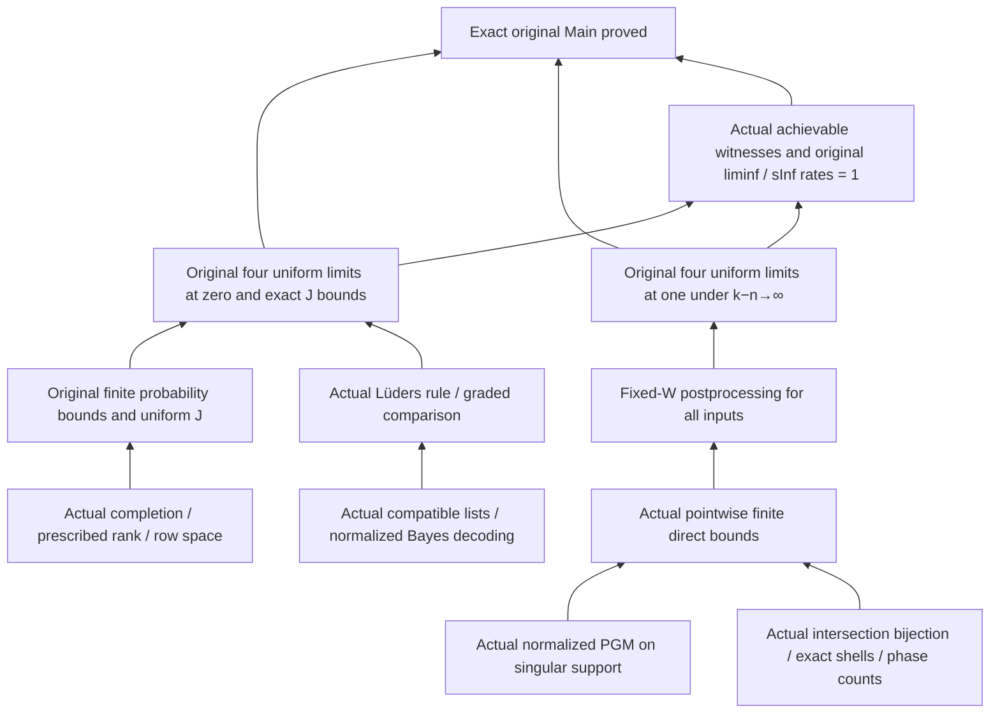

# Dependencies of the original Main proof

This is a reading guide. Actual dependencies are recorded in
[main-closure.json](validation/2026-10-11-direct-integration/main-closure.json)
and [lean-dependencies.json](lean-dependencies.json).
