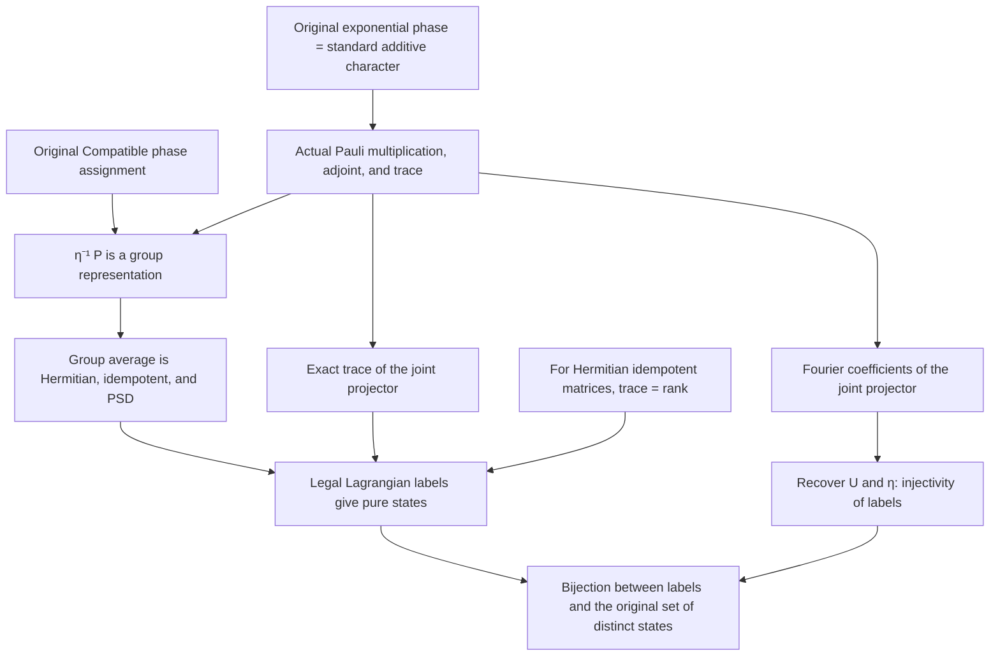

# Pauli Operators and Actual Stabilizer Projectors

Source freeze: `491d0ab`, on the private branch `codex/pauli-integration`; parent baseline: `35d925e`.
This stage ran in parallel with the work on the uniform asymptotic exponent J. The asymptotic task was the sole maintainer of the Mac working copy.
This task and three independent proof tasks used separate cloud branches and directories, with integration coordinated by this task.

## Scope of the proofs

All new physical theorems retain `p : ℕ`, `[Fact p.Prime]`, and arbitrary `n : ℕ`.
They include `p=2` and `n=0`. The public definitions in `Quantum/Pauli.lean`, `Quantum/Stabilizer.lean`,
`FixedConstraints/`, and `Main.lean` remain byte-for-byte identical to the original baseline.
The original section is `P(u,v)=X(u)Z(v)`; no inverse of two or restriction to odd primes was introduced.

| Proved local obligation | Lean declaration (prefix `StabilizerLearning.Quantum`) | Mathematical content |
|---|---|---|
| Character properties of the actual phases | `rootPhase_eq_stdAddChar`, `eigenPhase_injective` | Additivity, conjugation, nonvanishing, and injectivity for the original exponential definitions |
| Actual Pauli representation | `pauli_mul`, `pauli_conjTranspose_mul_self`, `pauli_conjTranspose` | Actual matrix multiplication, unitarity, and section phases |
| Character traces and orthogonality | `trace_pauli_pow`, `trace_pauli_conjTranspose_mul` | Trace `p^n` for zero displacement and zero otherwise; Hilbert–Schmidt orthogonality |
| Actual joint projectors | `jointProjector_mul_self`, `jointProjector_isHermitian`, `jointProjector_posSemidef`, `trace_jointProjector` | Projector properties are proved rather than assumed; the exact trace is `p^(−dim U) p^n` |
| Correct eigenvalue equation | `pauli_mul_jointProjector` | `P(z) Π(U,η) = η(z) Π(U,η)` |
| Physicality of legal labels | `labelProjector_isPureStabilizer` | The originally defined matrix is positive semidefinite, has trace one, and has rank one |
| Absence of duplicate labels | `trace_pauli_jointProjector`, `labelProjector_injective` | Fourier coefficients recover U and the complete Assignment |
| Bijection between labels and distinct states | `stabilizerLabelStateEquiv`, `card_stabilizerState_eq_labels` | An actual bijection between the original `StabilizerLabel` and `StabilizerState` |

## Actual dependencies

Audit adds 12 assertions about reachability in actual proof terms and continues to audit every project declaration recursively.
The group representations, characters, and spectral properties used in the proofs are instantiated from the original definitions.
No bijection, projector property, positive semidefiniteness, trace-one property, rank-one property, or counting formula is introduced as a new assumption.
The root entry point imports Main, and Main imports the new modules from this stage through Verified.
These imports establish actual build coverage; they do not mean that the still-missing main proof uses those modules.

## Obligations not discharged by this stage

- Construct an Assignment for every isotropic U. The current proofs take an actual compatible Assignment as input;
  this input does not silently replace the assertion that an assignment exists for every U.
- Show that every compatible complex unit phase can be encoded in `ZMod (2*p)`. The proved injectivity of phases does not establish surjectivity of the encoding.
- Establish the torsor equivalence between Assignments and ordinary characters, the exact cardinality, and the orthogonality and identity sum of the projectors associated with all assignments.
- Identify arbitrary transverse graph states with the existing odd-prime or binary coordinate density matrices; construct symplectic frames and prove Clifford covariance.
- Transport reports, Valid, and the full POVM class for arbitrary fixed W; establish the equal-fiber prior, exceptional mass, and the comparison of Lüders operations.
- Reduce the paper's verification task from a basis-free bounded-rank list to exact Bayes with a tail bound. It cannot be replaced directly by the coordinate optimum.
- Prove the direct construction and the original `FixedWNoCopyRateDiscount` theorem.

Thus, the overall `foundation:pauli-stabilizer` entry can only be marked as partially covered, not as having all dependencies proved.
The specific local obligations completed in the table above are upgraded to all dependencies proved only after the independent rebuild and recursive audit pass.
The main theorem remains a statement without a proof at this stage.

## Validation and remaining schedule

Both full-project builds and recursive axiom audits passed; see
`docs/validation/2026-10-11-pauli-projectors/comparison.json`.
The second run used a fresh directory, independently fetched the exact Git dependencies and official mathlib cache, and started with zero project olean files.
It used the same Linux toolchain after checking its version; it is not presented as a different operating system or a fresh virtual machine.
The two complete axiom logs are byte-for-byte identical, and the source hashes and actual dependency graphs match.
The only allowed axioms are `propext`, `Classical.choice`, and `Quot.sound`. All 94 specified dependency chains passed, including the 12 added in this round.
Separate hash records establish that the original main statement and public physical definitions are byte-for-byte unchanged.

The specific local results in the table now have **all dependencies proved**; the overall Pauli/stabilizer correspondence remains only partially covered.
The strict main-theorem release gate correctly rejected both runs because the final proof was absent.
The independent reproduction took 658.416 seconds in total. This measures build and audit cost, not the time needed to complete the mathematical proofs.

Reproduction command: in an independent checkout pinned to the source commit, run
`LAKE_NO_CACHE=true python3 scripts/reproduce.py --dest /data/lean/<fresh-directory>`.
If network conditions affect dependency downloads, a temporary loopback proxy may be set for this command without changing the source, version locks, or global network configuration.
The first attempt in this round stopped at an optional Reservoir download; the second encountered a GitHub TLS transfer error; the third succeeded in a fresh directory.
Only the third run is the independent acceptance result. The failed attempts are recorded separately, and the temporary proxy has been shut down.
Only the obligations actually proved in the table are removed from the remaining work; this does not establish the complete physical bridge.
The next independently testable unit is Assignment existence and the complete spectral decomposition, followed by the task comparison for arbitrary W.
There are no completed examples of those remaining units from which to estimate their duration reliably, so no calendar estimate or GPT/GPU-hour estimate is given. Compilation time is used only for resource planning.
