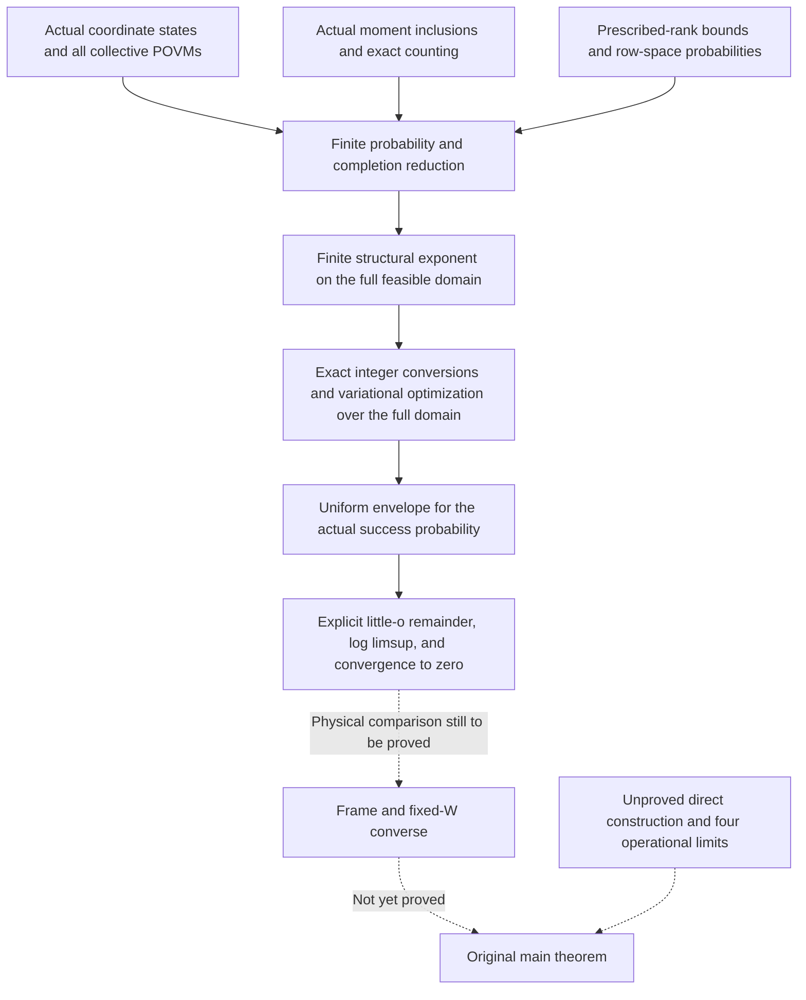

# Uniform Asymptotic Converse for the Coordinate Experiment

This stage connects the proved finite probability bound to the paper's `thm:converse-common-asymptotic-reduction`
(`paper/main-stabilizer2.tex:4872–4902`). The frozen proof commit is
`08c15fea0aca23c8b8b93839551a222dfa83f857`.

The final entry point is
[`coordinate_common_converse_source`](../StabilizerLearning/Bounds/CoordinateConverse.lean).
The paper correspondence map marks this item as a completed coordinate asymptotic result with remaining obligations to bridge to the original physical meaning.
It does not assume that the matrix-phase model is definitionally equal to the states and targets on the physical transverse chart.
The probability is the supremum of success probabilities over all legal collective POVMs in the original odd-prime half-quadratic-phase or binary Z4-phase coordinate experiment.
Tensor copies are taken before averaging over hidden parameters. The previously proved basis change and report bijection cover all POVMs.
The result does not assume the finite probability bound, completion-set inclusions, counting results, scalar optimization, or asymptotic estimates.

## Original hypotheses and conclusions

Fix any prime `p`. The natural-number sequences `m(N), k(N)` satisfy the paper's little-o conditions
`m=βN+o(N)` and `k=αN+o(N)`, where `0<β≤1` and `0≤α<1`.
The model itself requires `m(N)≤N` eventually; in particular, for `β=1`, this condition does not follow from convergence of the ratio.
The proof derives `k(N)≤N` from `α<1` rather than adding it as a hypothesis.
`SourceScaling.lean` proves equivalence between three formulations: native `Asymptotics.IsLittleO`, ratio limits, and explicit additive remainders.

The source exponent is retained:

```text
J(α,β) = β(1−α−β/2)       if α≤1−β,
         (1−α)²/2         otherwise.
```

The final theorem gives `J>0`, the explicit remainder `R=o(N²)` below, the eventual bound
`P≤p^(−J(α,β)N²+R)`, the actual real-valued `limsup(log_p(P)/N²)≤−J`, and `P→0`.
Neither `P>0` nor the coboundedness below needed for the real-valued limsup is assumed.
An actual POVM that always guesses one label gives `P≥p^(−Dvis)>0`, and hence `log_p(P)/N²≥−3` when `N≥1,m≤N`.

## Finite domain and uniform error

Write `N=m+b`, where `b` is the number of lower rows. The full real feasible domain is:

```text
0≤u≤a,  a+u≤K,  a≤N−M,
0≤ell≤M,  ell≤N−M−a+u,
0≤t≤M−ell,  a−u+2ell+t≤K.
```

No additional conditions `ell+t≥u` or `K−a−ell≥0` are imposed, and negative signed differences are not forcibly truncated to zero in the natural numbers.
Over the full closed domain `0≤K,M≤N`, `ConverseVariational.lean` proves that the **exact maximum** of the clipped quadratic objective is `−cost(N,K,M)` and supplies feasible maximizers in both regions.
For `N=1`, this is `−J`; for general positive `N`, it is exactly `−N² J(K/N,M/N)`.

Finite half-integer terms are handled by divisibility and exact conversions. The odd-prime branch uses the full feasible domain in the augmented total dimension `N+1`,
then returns to `N` using monotonicity of the cost in the total dimension. This yields `net≤k−cost(N,k,m)` uniformly over all actual row-space classes and feasible completion parameters.
In the binary branch, the enhancement term cancels against the actual label denominator, yielding the stronger bound `net≤−cost(N,k,m)`.
No `O(N)` term is assumed.

The actual finite probability and the original `min(1,…)` are retained at the input. The proved net-exponent bound is used only after multiplication by the nonnegative row-space probability factor.
The sum still ranges over the positive-probability support; the number of terms is controlled solely by the support-size bound `(k+1)²`.
This gives the uniform envelope, independent of `a,u,ell,t` and valid for all `N>0, k≤N`:

```text
P ≤ 16 (k+1)² (m+1)² (16p)^k · p^(k−N² J(k/N,m/N)).
```

The explicit remainder is:

```text
L(p,m,k) = log 16 + 2 log(k+1) + 2 log(m+1) + k log(16p) + k log p
R(p,α,β,N,m,k) = L(p,m,k)/log p + N² [J(α,β)−J(k/N,m/N)].
```

`ConverseAsymptotics.lean` proves continuity of `J`, convergence to zero of the logarithm of every prefactor divided by `N²`, and `R/N²→0` for every sequence satisfying the source scaling.
This controls the entire discrete feasible domain, rather than a single parameter chosen after the fact.
No common convergence rate for different scaling sequences is assumed, so no common N threshold is claimed across all little-o sequences.

## Boundary cases and main dependency chain

- `α=0`: includes zero copies and arbitrary `k=o(N)`; `J=β(1−β/2)`.
- `β=1`: allows the lower dimension to be zero; `J=(1−α)²/2`, retaining the actual dimension condition.
- `α+β=1`: the two branches meet exactly, with `J=β²/2`.
- `β=0` and `α=1` on the closed square: scalar optimization and the boundary identities `J=0` are proved, but the source theorem does not claim `P→0` on these boundaries.
- Zero rank, zero radical, empty completion classes, `ell=0/m`, and `t=0/(m−ell)` are all covered by the full finite domain and exact counting.
- `N=0` does not use the finite formula that divides by `N`. The `atTop` proof discards only finitely many initial terms and places no restriction on initial sequence values.



`StabilizerLearning → Main → Verified → CoordinateConverse` is connected to the root build.
`Audit.lean` checks recursive dependencies in the actual proof terms, including links from new leaf theorems to the finite counting chain and key links involving little-o,
the guessing measurement, feasibility over the full domain, exact half-integer conversion, and attainment of the maximum.
Reachability through root imports does not establish the main theorem: `FixedWNoCopyRateDiscount` still has only its original statement at this stage, so the release gate should reject it.

## Acceptance and remaining work

Local and cloud results for the frozen source, per-file hashes, and the axiom-audit comparison are recorded in the
[acceptance records for this stage](validation/2026-10-11-uniform-asymptotic/README.md).
The cloud run used a fresh dependency directory under `/data/lean`, fetched the pinned Git commits and an independent official mathlib cache,
and compiled all project sources from scratch. Reuse of the host and of the Lean compiler whose version had been checked is recorded accurately.

The remaining main line consists of the complete physical Pauli/projector/stabilizer/frame semantics, fixed-W exact and Lüders verification comparisons,
exceptional mass, the direct construction, the four operational limits, and the copy-rate main proof.
The existing constants `16` and `16p` suffice to prove the paper's J conclusion at this stage. This does not upgrade the exact interface for the specified infinite-product κ constant or the exact PGM equalities to completed results.
Schedule revisions follow the [remaining-obligations list](remaining-work.json); build times are not converted into proof time or GPT-hours.
