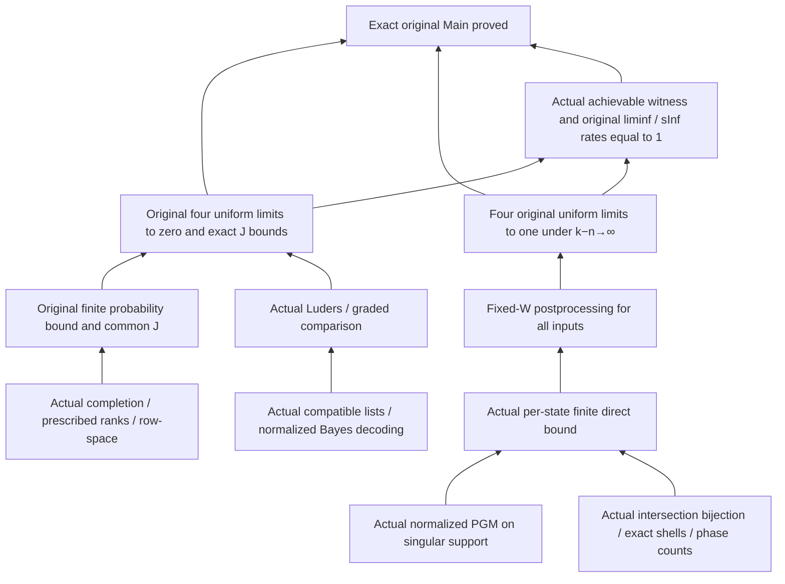

# Original fixed-W main theorem: complete proof and acceptance in two environments

Frozen mathematical and verification inputs: `6d17da20d7a7625333ecf87d23824f031a01a6ae`.
Lean 4.24.0 and mathlib `f897ebcf72cd16f89ab4577d0c826cd14afaafc7` remain locked.

**The complete original main theorem is closed**:
`StabilizerLearning.fixedW_noCopyRateDiscount : StabilizerLearning.FixedWNoCopyRateDiscount`.
The exact-type release gate passed, with no additional normalization, bijection, counting, success-probability, physical-equivalence, or asymptotic-bound assumptions.
The original target definition, Rates, Task, shared physical definitions, paper, and version locks are unchanged from the preceding acceptance stage; Main only gained the proof and updated explanatory text.

[Original target and proof](../../../StabilizerLearning/Main.lean) · [Definition-preservation evidence](source-preservation.json) · [Independent semantic review](independent-review.md)

## Mathematics closed in this stage

1. Actual normalized PGM: extract unit vectors from the original pure-state matrices while preserving the actual tensor densities; form the inverse square root of the Gram matrix on its support, setting it to zero on the kernel and assign the complementary-space effect to a valid outcome. Every effect is PSD and their sum is I; the complement contributes zero on every original signal. The actual success probability equals the squared modulus of the corresponding Gram-square-root diagonal entry and satisfies a per-state overlap-energy bound. Singular supports, all primes, zero dimensions, and zero copies are included.
2. Actual overlap shells: actual intersection fibers are bijective with symmetric matrices and have exact cardinality `p^(r(r+1)/2)`; the actual shell is the Σ-set of actual intersection subspaces and their fibers. Compatible assignments are counted exactly by `p^r`; for `k>0`, the actual tensor Born sum yields the exact energy formula. The Grassmann cardinality is expanded into the literal finite Gaussian product, indexed by the actual intersection-subspace dimension `n−r`.
3. Original fixed-W postprocessing for all inputs: prove `dim(L∩W⊥)=m+dim(L∩W)`, choose an actual complement K, and restrict the original phase assignment to obtain a valid report for every input. Apply a fixed pushforward to the entire POVM, retaining exceptional inputs, multiple correct reports, and the full measurement space. When `k≥n+1`, all four optima are at least `1−4*dampedTail`.
4. Original additive-overhead direct result: from real `k_n−n→+∞`, derive eventual finite feasibility and uniform decay of the tail bound, obtaining the original four limits to one with quantifiers `∀ε>0 ∃N ∀n≥N ∀W`. The assumption is not strengthened to copy ratio>1.
5. Rates and Main: use `m_n=floor(βn)`, `k_n=n+Nat.sqrt n`, and an actual valid W to construct a rate-one achievability witness; the original converse excludes all achievable rates below 1, and the original nonempty set's `liminf/sInf` gives both exact rates equal to 1. Combining these results with the proved common-J converse completes the original Main.
6. Equality of all four optima for constraints of equal dimension: actual symplectic/Clifford transport carries the correct section phase and gives bijections on all original states, reports, and POVMs. The worst-state aggregation for each measurement is preserved before taking the supremum over measurements; sup and inf are never exchanged.

The original theorem's two common-J bounds, complete-prior exceptional term, and four zero-limit conclusions for exact identification and verification are retained along the previously accepted chain. No extra claim is made that verification limits have the exact-identification quadratic exponent.

The diagram above is a reading aid; see [main-closure.json](main-closure.json) for machine-extracted actual proof paths and [lean-dependencies.json](../../lean-dependencies.json) for the complete declaration graph. Exact symmetric fibers, phase counting, and support normalization all occur in Main's actual dependencies. The Gaussian product expression and constraint covariance are separately audited formal results; no claim is made that Main uses every auxiliary interface.

## Clean builds and axiom audits

- Mac: clear project artifacts, confirm zero project oleans, rebuild the entire root, and run `check.py --require-main-proof`; this `lake clean` also caused the required mathlib modules to be rebuilt from source.
- Linux: use a new directory on the mounted 200 GiB disk, independently check out all locked Git dependencies and download the official cache, start with zero project oleans, and run `reproduce.py --require-main-proof`. No project oleans are reused.
- Both platforms reuse pinned compilers whose versions and installation-archive SHA-256 values have been checked; this is not a full OS or compiler bootstrap. The independent dependency directories have no symlinks/object alternates; dependency commits and the absence of tracked oleans were checked.
- All formal and verification input hashes match; complete axiom logs are byte-for-byte identical; both exact-type Main gates succeeded. All project declarations, including definitions and private declarations, were recursively audited, allowing only `propext`, `Classical.choice`, and `Quot.sound`, with no new mathematical axiom or sorryAx.

[Two-environment comparison](comparison.json) · [Mac checks](local/check.json) · [Independent Linux reproduction](fresh/reproduction.json) · [Isolation checks](cloud-postflight.json) · [Exact-type release log](local/main-release-gate.log) · [Acceptance plan](acceptance-plan.json)

Another process implemented the PGM and performed independent reviews; this process integrated all modules and accepted the complete frozen source. The [two PGM component-stage acceptance runs](../2026-10-11-pgm/comparison.json) and their consistency with the final source were checked and are listed separately as component evidence, rather than replacing acceptance of the identical full Main source. The Mac had one writer; cloud workers each used isolated working directories. GitHub remained assigned to other processes throughout.

A further [independent expanded-statement acceptance run](independent-expected/README.md) rebuilt from zero project oleans, independently restated the quantifiers and J/rate definitions of the original Theorem 4.12, and had the kernel check that Main directly proves it. Its actual axioms remained the three standard logical axioms. This run reused an independently copied, verified Linux dependency cache and serves as supplementary evidence.

The complete two-platform audit covers 2,759 theorem declarations, 3,448 declarations in total, and 345 required dependency links; these numbers describe audit coverage, not a completion percentage.

## Scope and remaining schedule

**The original fixed-W Main requested for this stage is complete, with zero remaining main-proof packages.** This conclusion rests on the exact type, proof dependencies, clean rebuilds, and axiom audits, not line counts, declaration counts, compilation minutes, or GPU hours.

This does not mean that every auxiliary interface in the paper has been formalized. Separately outstanding are transitive-PGM minimum-error optimality and its dual certificate, equal success probabilities, finite-size full-identification worst-case=average, the original specified κ infinite product and finite constants, the Gaussian-symmetry wrapper from the `n−r` product to the `r` product, and certain refined/literal operator interfaces listed earlier. The proved per-state PGM bound and constant 4 suffice to imply exactly the same original Main; these uncovered conclusions have not been turned into assumptions.

There is currently no reliable total number of days based on accepted packages for these extra interfaces, so no new calendar estimate is invented. The existing 8-core cloud CPU machine, approximately 30 GiB of memory, and mounted disk were sufficient for this stage; no additional GPU or larger machine was needed.

[Itemized theorem correspondence](../../theorem-map.md) · [Remaining work](../../remaining-work.json) · [Main-statement quantifier review](../../main-statement.md)

## Release verification

The [versioned release](https://github.com/Imine20/Lean-formalization-for-stabilizer-state-identification/releases/tag/v1.0.0) provides the new verification record and complete logs for this repository's exact cited commit. Historical milestone records describe their own earlier checked inputs and do not replace that release verification.
