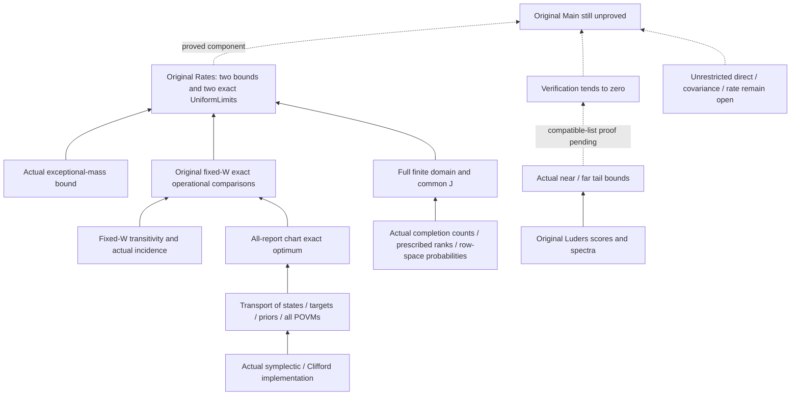

# Acceptance of arbitrary frames and the original fixed-W exact converse

Frozen inputs: `ff7e57b13fb0bae723c48f969daf72fef590f972`. Lean 4.24.0 and mathlib `f897ebcf72cd16f89ab4577d0c826cd14afaafc7` remain locked.

**The auxiliary proofs listed here and the exact-converse component of the original main target are accepted; the original `FixedWNoCopyRateDiscount` remains a statement only.**
The original paper, Main, and shared Pauli/state/task/Rates definitions remain byte-for-byte unchanged. The final main theorem has no proof yet, and the strict release gate correctly rejects it.

## What was actually closed

- For any public ordered Lagrangian frame, construct an actual symplectic standardization and Clifford unitary implementation, retaining the complete XZ cocycle; this includes p=2 and never divides by two.
- Bidirectional transport is established for the original distinct density-matrix states, complete restricted-assignment targets, uniform prior, and all k-copy POVMs. The per-state scores and sets of attainable average/worst-case scores for exact identification and verification are equal; `sup_M inf_x` is preserved.
- Actual generic unique reports, symplectic transitivity for fixed W, positive constant completion degree, and an actual incidence decomposition are all proved. Actual merging and reverse pushforward of the original all-report POVMs yield chart exact optimum = physical P_id.
- The original finite n,m,k operational comparisons are closed: worst exact ≤ P_id; average exact ≤ δ+(1−δ)P_id. The exceptional mass is an actual event under the full-state prior, satisfies the paper's rational upper bound and δ≤p^(−m), and is zero when n=0.
- `fixedConstraint_exact_uniform_converse` directly returns the original `Rates`' two bounds and two exact `UniformLimit` conclusions: the same e and C=1 precede all eventual W; e is the existing uniform remainder with e/n²→0. The worst-case bound is p^(−Jn²+e), and the average bound retains the p^(−m) term.

[Core interface](../../../StabilizerLearning/Bounds/FixedConstraintConverse.lean) · [Finite comparisons](../../../StabilizerLearning/FixedConstraints/OperationalComparison.lean) · [Scope and quantifier review](semantic-review.json)

## Acceptance of the Lüders results

The complete evidence for the other process's frozen `20e9cd5` was received, and the hashes of its mathematical files were checked against the integrated version. The original positive-probability normalization denominator, zero-outcome branch, all reports, and learner POVMs are preserved. Actual average scores, intersection-phase spectra, probability validity, affine exact/verification comparisons, and actual codimension tail bounds passed acceptance.

[Independent review record](peer-luders-acceptance.json) · [Original dual acceptance](../2026-10-11-luders-verification/comparison.json)

## Clean rebuilds and axioms

The Mac ran the complete `check.py` after removing the project's build artifacts, retaining its dependency cache. The cloud run began with zero project artifacts in a new directory, independently checked out exact dependencies, and downloaded the official cache; it reused the compiler after verifying its SHA and version, without claiming a different operating system.

The source hashes and complete audit logs from both hosts are byte-for-byte identical. A total of 2898 project declarations, including definitions and 2290 theorems, were audited; 255 actual proof dependencies passed checks. Only `propext`, `Classical.choice`, and `Quot.sound` are allowed. These counts describe audit coverage, not completion percentages or schedule metrics.

[Final dependency closure](exact-converse-closure.json) · [Immutable evidence comparison](comparison.json) · [Mac record](local/check.json) · [Independent cloud record](cloud/reproduction.json) · [Original-target gate](local/main-release-gate.log)

The first cloud-driver precheck encountered Python 3.10's lack of `hashlib.file_digest` and did not reach the build. The failure log was retained, hashing was changed to streaming SHA-256, and final acceptance ran in another fresh directory. The other process's earlier audit exit 139 and evidence for the chunked repair are also preserved unchanged; failed records were not discarded.

## Proved dependencies and remaining gaps

The complete finite fixed-W exact result is proved through actual unordered completion subspaces. The paper's separately stated ordered-tuple count `|GL(m)| p^(m(n−m))` and its literal T-marginal have not been separately formalized; the correspondence table retains their partial status rather than presenting the alternative route as a literal proof of every original lemma.

The verification `nearReportProbability` does not filter for phase compatibility and cannot be substituted directly into a compatible-list counting bound. Refined verification and full basis-free verification also have different report alphabets. This stage does not claim verification convergence to zero, nor treat a fixed 1/p residual as a proof of such convergence.

Another process has frozen a new graded-verification candidate `583897b` on an independent branch and is rebuilding and auditing it; that candidate is outside this stage's `ff7e57b` frozen inputs and is not yet counted as accepted.

The remaining critical path consists of the Bayes reduction for actual phase-compatible lists and uniform verification convergence to zero, an unrestricted state-uniform direct construction, and covariance/rate/final Main. No blockers remain within this stage's bounded acceptance checklist; there are not enough comparable completed proof packages to give reliable calendar estimates for those open packages. No estimates are derived from build times, theorem counts, or GPU hours.

[Remaining work and basis for estimates](../../remaining-work.json) · [Complete itemized correspondence](../../theorem-map.md)

GitHub is handled by other processes. This task pushes only the explicitly designated private origin branch; sources, configuration, and necessary evidence remain available, while completed static dated snapshots are separately backed up and readback-verified as requested.
