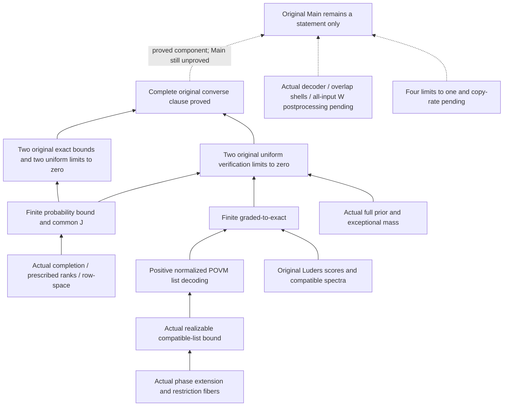

# Original graded verification and the complete converse: three-way acceptance

Mathematical freeze: `583897b83f2714c9b1a4d27fb1cfd2fc988ee7e8`. Mac integration: `9c6bacadd5fd4231f0e59955e17e565e17b7b56e`.
Lean 4.24.0 and mathlib `f897ebcf72cd16f89ab4577d0c826cd14afaafc7` remain locked.

**The entire converse clause of the original main target has been accepted; the complete Main is still a statement only.**
The original paper, Main, and shared Pauli/state/task/Rates definitions are unchanged; counting, probability, and asymptotic bounds have not been made assumptions of the endpoint theorem.

## Proofs actually closed

- Actual phase-assignment extension and exact restriction-fiber cardinalities; the uniform bound `L_D <= 16*p^(2*n*D+D)` for the original realizable, phase-compatible lists when `D≤m`, covering all primes and finite-dimensional boundary cases.
- For any original POVM, construct a positive semidefinite, normalized list decoder, allowing distinct report/target alphabets and noninjective targets; the average retains the actual input prior. Empty lists have a valid fallback output.
- The finite bound from the original Lüders compatible-near event to exact identification, and restoration of the actual full prior: `S_av <= delta+(1-delta)*(L_D*P_generic_exact+p^(-(D+1)))`.
- Set `D=Nat.sqrt N` and prove its growth, feasibility, and the `o(N^2)` size of the extra exponent. Retain the common J, square-root tail, and complete-prior exceptional term; choose the remainder and threshold uniformly before all W.
- `fixedConstraint_uniform_converse` returns the original two exact bounds and four original `UniformLimit ... 0` conclusions, preserving all POVMs, all inputs, and the `sup_M inf_x` order.

[Constructive Bayes reduction](../../../StabilizerLearning/FiniteCopy/BoundedList.lean) · [Finite graded comparison](../../../StabilizerLearning/FixedConstraints/GradedComparison.lean) · [Original converse endpoint](../../../StabilizerLearning/Bounds/VerificationConverse.lean)

## Acceptance evidence

Both Linux checks from the other process passed: the execution copy's project artifacts were cleared, and a second directory independently checked out exact dependencies and obtained the official cache, with zero project oleans before building. This process additionally cleared the Mac project cache, rebuilt the entire root, audited all declarations, and ran the original Main release gate. Existing compilers on both platforms were reused; their versions and installation-archive SHA-256 values were checked against the locks.

The three complete axiom logs are byte-for-byte identical, as are the hashes of the 160 frozen formal inputs.
The audit covers 3060 project declarations, including 2434 theorems; all 283 specified actual dependencies passed. Only `propext`, `Classical.choice`, and `Quot.sound` are allowed. These counts describe audit coverage, not completion percentages or schedule metrics.

[Three-way comparison](comparison.json) · [Mac checks](local/check.json) · [The other process's two Linux records](../2026-10-11-graded-verification/comparison.json) · [Independent semantic review](independent-review.md) · [Actual proof paths](converse-closure.json)

An early dependency precheck named the high-level `restrictAssignment_surjective` as a dependency of assignment-fiber counting, whereas the actual proof uses the character-level `restrictionCharacterHom_surjective`. The final audit checked this actual path; the initial failed precheck log is retained in the other process's evidence directory and was neither deleted nor treated as a pass.

## Scope and remaining schedule

The actual sufficient list bound is proved; the paper's exact Gaussian shell sum and specified kappa coefficient remain unproved and must not be marked as closed original formulas merely because the converse is closed. Explicit uniform quantified bounds and a vanishing envelope specific to the generic case are proved, but their named Tendsto wrapper has not been separately stated; the original full task's two uniform verification limits have complete endpoints.

The original Main release gate still correctly rejects the project: unrestricted direct achievability, fixed-W postprocessing for all inputs, the four limits to one, and rate/Main closure are missing. Full covariance, refined verification, and related interfaces are listed separately in the correspondence table. Importing Main from the root does not mean that a main proof exists.

The list, Bayes, graded, and original-converse obligations actually closed in this stage have been removed from the remaining critical path. The next acceptance package is an actual per-state decoder, actual overlap shells, and fixed-W postprocessing for all inputs. No comparable complete direct proof is available to support a reliable total number of days; audit minutes, declaration counts, and GPU hours are not converted into proof-development time.

[Inventory of remaining proof packages](remaining-proof-packages.md) · [Remaining-work checklist](../../remaining-work.json) · [Itemized theorem correspondence](../../theorem-map.md)

The cloud uses the user-authorized mounted data disk `/data` (nominally 200 GiB); it reuses the other process's two independent acceptance runs rather than launching a third cloud build. The Mac has a single writer. GitHub remains assigned to other processes; this task synchronizes only the private branch.
